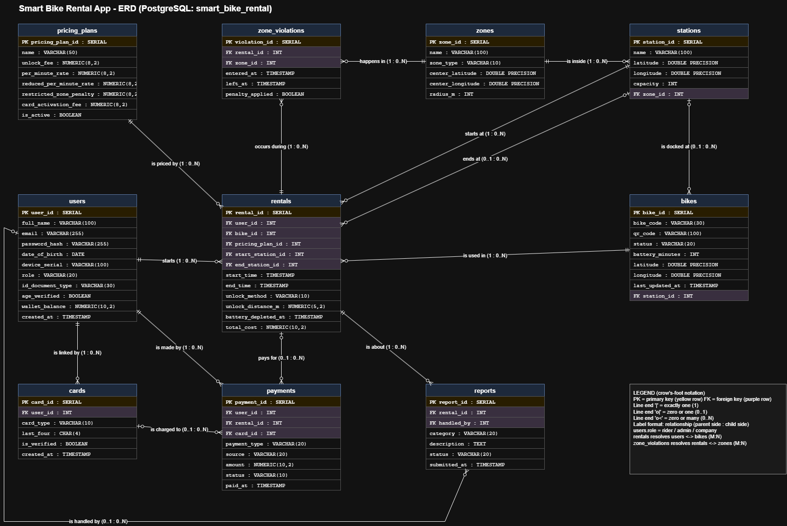

# Smart Bike Rental App - Youssef Guirguis Shenouda

Software Engineering - GIU Cairo - Milestone 2

## Team

| Name | ID | Role in team |
|------|----|--------------|
| Youssef Guirguis Shenouda | 19011526 | Team leader (solo project) |

## ERD

Editable diagram: [erd.drawio](docs/erd.drawio)

## Traceability: entities to user stories

| Entity | Justified by user stories |
|--------|---------------------------|
| users | US-001, US-002, US-003, US-004, US-014 |
| pricing_plans | US-008, US-010, US-012, US-013, US-014, US-019 |
| zones | US-007, US-008 |
| stations | US-006, US-007, US-016, US-023 |
| bikes | US-011, US-016, US-017, US-018, US-022, US-025 |
| cards | US-009, US-010 |
| rentals | US-011, US-012, US-013, US-019, US-023 |
| payments | US-009, US-010, US-012, US-015 |
| zone_violations | US-008 |
| reports | US-020, US-021 |

Stories with no table of their own: US-005 (live location) and US-024 (camera access) are device permissions; US-015 (outstanding payment) is derived by comparing `rentals.total_cost` with successful `payments`; US-014 (wallet minutes) is calculated from `users.wallet_balance` and `pricing_plans`.

The backlog has no Admin-only stories, so the Admin role is the `admin` value of `users.role`, and admins handle problem reports (`reports.handled_by`).

## Database

- DBMS: PostgreSQL 18
- Database name: smart_bike_rental
- Scripts are in the `schema/` folder; run them in numeric order:
  1. `01_create_tables.sql` - 10 tables
  2. `02_constraints_indexes.sql` - minimum-age trigger, one-active-rental rules, indexes
  3. `03_seed_data.sql` - sample rows
  4. `04_test_constraints.sql` - optional, statements that must all fail
